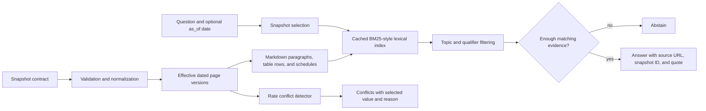

# Interface.ai temporal knowledge system

An offline, deterministic Python solution for the Interface.ai Knowledge System Engineering Challenge. It answers questions from dated website snapshots, keeps evidence and source URLs attached, distinguishes earlier snapshot answers from current ones, reports detected rate changes, and abstains when a requested numeric fact is not supported.

The repository contains the implementation and synthetic regression tests only. It intentionally excludes the participant kit, website snapshots, and evaluation data.

## Architecture



### Retrieval and temporal reasoning

- Ingestion validates snapshot IDs, ISO dates, URLs, and page text. Malformed pages are logged and skipped; malformed snapshot metadata raises an error.
- Markdown is divided into paragraphs, individual table rows, and grouped lobby/drive-up schedules. A cached BM25-style lexical index uses query synonyms and a small source-relevance prior; it has no external model or network dependency.
- With no date, the newest ingested snapshot is selected. `as_of` (or a month/year phrase in a question) selects the newest snapshot taken on or before that date.
- For a selected snapshot, a page URL omitted from a later crawl is carried forward from its latest observed version. This handles incomplete recrawls in the supplied kit. It deliberately does not infer a deletion from a missing page; see limitations below.
- Explicit numeric qualifiers such as a vehicle term or model year are checked against the selected evidence before answering. Rate questions require a percentage supported as an APR/APY/dividend rate or a rate table row; a nearby loan-to-value percentage alone is not enough.
- If an answer needs a value that is absent, mismatched, or unsupported by the retrieved evidence, the engine returns a low-confidence abstention instead of substituting an adjacent product's value.

### Conflicts and citations

Conflict detection compares single-percentage rate statements with the same canonical URL and normalized surrounding text across dated snapshots. It keeps APR/APY distinctions, avoids treating multi-percentage tier rows as one fact, and selects the latest dated observation as the current value. The returned conflict includes both observed values, source URLs, snapshot IDs, a resolution, and a reason.

Every non-abstaining answer has `Source` entries containing the original URL, snapshot ID, and an evidence quote. Table rows and grouped schedules retain their originating page, so citations remain traceable to the supplied snapshot rather than a live site.

## Setup

Requirements: Python 3.9 or newer. Runtime dependencies: Python standard library only.

```bash
git clone https://github.com/pranavv1103/interfaceai-knowledge-system.git
cd interfaceai-knowledge-system
python3 -m venv .venv
source .venv/bin/activate
python -m unittest discover -s tests -v
```

No environment variables or API keys are required by the solution. The optional evaluator `--judge` flag uses `ANTHROPIC_API_KEY`; that key is consumed by the challenge harness only and is not read by this project.

## Run the supplied evaluation

Obtain the participant kit separately and set `KIT` to its root folder. The kit and its website snapshots are provided for the challenge and must not be copied into this repository.

```bash
KIT=/path/to/hackathon-knowledge-kit-participant
python "$KIT/harness/run_eval.py" \
  --submission "$PWD" \
  --snapshots "$KIT/snapshots" \
  --eval "$KIT/eval/public_eval.jsonl" \
  --out /tmp/interfaceai-public-results \
  --repeat-sample 20
```

The harness unpacks the kit's `snapshots_zip/` into `snapshots/` on its first run when needed. For the supplied self-test:

```bash
python "$KIT/harness/run_eval.py" \
  --submission "$PWD" \
  --snapshots "$KIT/harness/selftest/snapshots" \
  --eval "$KIT/harness/selftest/eval.jsonl" \
  --conflicts-gold "$KIT/harness/selftest/conflicts_gold.json" \
  --out /tmp/interfaceai-selftest-results
```

To run syntax checks independently:

```bash
python -m compileall -q solution.py knowledge_system tests
```

## Measured results

Measured locally with the supplied harness, public 40-question set, and no LLM judge:

| Run | Final score | Notes |
|---|---:|---|
| Supplied starter baseline | 0.093 | Baseline recorded before implementation |
| Current implementation | 0.969 | 40 questions; zero harness errors or stale-trap hits |
| Supplied self-test | 1.000 | 5 questions; conflict F1 and resolution accuracy both 1.000 |

On the latest public run, p50 answer latency was 0.04 s, p95 was 0.09 s, and the maximum was 0.17 s. Repeat and paraphrase consistency were both 1.000. The remaining zero-scored public item asks for all certificate rates but has an empty `must_include` list; the supplied deterministic scorer assigns zero when that list is empty unless its optional LLM judge is enabled. The answer itself lists the 12 certificate terms and their rates/APYs from the current snapshot.

These are practice-set results, not a claim about the hidden evaluation.

## Tradeoffs and limitations

- Lexical retrieval is easy to run offline and is deterministic, but it can miss paraphrases that share few words with the source. A production deployment could add a local or managed semantic retriever while preserving the same evidence and qualifier checks.
- Carry-forward supports partial recrawls, but a page that was truly removed can remain available until an explicit deletion/tombstone signal is added.
- Conflict detection targets repeated single-percentage statements on the same URL with normalized matching context. It does not solve every semantic contradiction across unrelated pages, calculate changes in derived values, or decide which tier a user intends.
- Internal dates and effective dates are not always explicit or consistent. Snapshot dates are used when no more specific evidence is available; promotional expiry and page-removal semantics need richer extraction.
- Some branch schedules appear in dated branch-opening stories rather than a canonical hours feed. The contact locator is cited for finding a branch, while schedule statements cite the supplied page that actually contains the hours.
- The public practice scorer has one certificate-list question with no deterministic required tokens, so the answer is not credited without the optional external judge. No API credentials were available or needed for the solution run.

## Engineering review guide

`solution.py` adapts the challenge contract to `KnowledgeEngine`. Ingestion and page carry-forward live in `knowledge_system/engine.py` and `knowledge_system/ingestion.py`; chunking and lexical ranking live in `knowledge_system/retrieval.py`; dated rate conflict detection lives in `knowledge_system/conflicts.py`; date parsing and snapshot selection are in `knowledge_system/temporal.py`. Tests use synthetic pages so they can be run without redistributing the supplied corpus.
